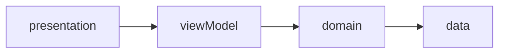

# Manual de desarrollador

Transporte exclusivo estudiantil de la UTEZ. Este manual describe el código que hay hoy, las convenciones para extenderlo y las reglas del enunciado que el equipo debe respetar. El caso completo está en [proyecto-integrador.md](proyecto-integrador.md).

La tarea de esta base es [T01_ARCH, issue #33](https://github.com/DMI-2026/transporte-estudiantil-utez/issues/33): carpetas, inyección de dependencias, paquetes base, tema y una aplicación que compila.

## 1. Propósito

La app permite a un estudiante de la UTEZ reservar asiento en una combi aliada, ver la ruta y abordar con un QR. Hay tres roles:

- **Estudiante:** reserva, mapa, abordaje, viaje e incidentes.
- **Operador:** inicia el recorrido, comparte ubicación, muestra el QR y la lista de abordaje.
- **Administrador:** aprueba credenciales y administra rutas, paradas, salidas e incidencias. La cuenta de administrador se crea en la consola de Firebase; nadie puede registrarse con ese rol.

El backend es Firebase. El cálculo de ruta y de ETA es OpenRouteService. El mapa lo dibuja Google Maps. Esas integraciones todavía no están implementadas: este hito deja el lugar donde van a vivir.

## 2. Stack y versiones

Versiones fijadas en `pubspec.lock` con Flutter 3.47.7 y Dart 3.13.5 (`environment.sdk: ^3.13.5`).

| Paquete | Versión | Uso en esta base |
|---|---|---|
| flutter | 3.47.7 | SDK |
| dart | 3.13.5 | SDK |
| go_router | 18.1.1 | Navegación declarativa |
| firebase_core | 5.0.0 | Arranque de Firebase |
| cloud_firestore | 7.0.0 | Acceso a Firestore, registrado en get_it |
| get_it | 9.3.0 | Inyección de dependencias |
| google_fonts | 6.3.3 | Source Sans 3 |
| cupertino_icons | 1.0.9 | Iconos iOS incluidos por la plantilla |
| flutter_lints | 6.0.0 | Reglas de análisis (dev) |

Identificador de la aplicación: `mx.edu.utez.transporte_estudiantil`. Versión de producto: `1.0.0+1`.

Paquetes previstos por el enunciado y todavía no agregados: `firebase_auth`, `firebase_storage`, `firebase_messaging`, `google_maps_flutter`, `geolocator`, `permission_handler`, `image_picker`, `mobile_scanner`, `qr_flutter`, `flutter_local_notifications`, `connectivity_plus`, `url_launcher`, `flutter_secure_storage` y el cliente HTTP de OpenRouteService. Se agregan en la tarea que los usa. Deben venir de un publisher verificado.

Herramienta nativa ya declarada: plugin de Gradle `com.google.gms.google-services` 4.5.0. Solo se aplica si existe `android/app/google-services.json`.

## 3. Cómo levantar el proyecto

Requisitos: Flutter 3.47.7 (canal stable), Android SDK para el emulador Android y Xcode para iOS. Comprueba el SDK con `flutter --version`.

```bash
git clone https://github.com/DMI-2026/transporte-estudiantil-utez.git
cd transporte-estudiantil-utez
flutter pub get
flutter run
```

La app arranca en la pantalla de inicio con el tema institucional. Firebase permanece apagado hasta que exista configuración nativa.

Para activar Firebase:

1. Copia `env/example.json` a `env/dev.json`. Ese archivo está en `.gitignore`.
2. Coloca `google-services.json` en `android/app/` y `GoogleService-Info.plist` en `ios/Runner/`. Tampoco se versionan.
3. En `env/dev.json` pon `"USE_FIREBASE": true` y la llave de OpenRouteService cuando exista.
4. Arranca con las variables de compilación:

```bash
flutter run --dart-define-from-file=env/dev.json
```

`USE_FIREBASE` se lee con `bool.fromEnvironment` en [lib/src/core/firebase/firebase_bootstrap.dart](../lib/src/core/firebase/firebase_bootstrap.dart). Si vale `false`, `Firebase.initializeApp` no se ejecuta. Si vale `true`, Firebase usa la configuración nativa del proyecto. El emulador de Firebase (Auth, Firestore, Storage y Functions) se conecta en la tarea que consuma cuota real; en desarrollo no se apunta a producción.

Análisis y pruebas:

```bash
flutter analyze
flutter test
flutter build apk --debug
```

## 4. Arquitectura

El flujo de una funcionalidad es vista, view model, repositorio y servicio. La biblioteca de estado (Bloc, Provider u otra) se elige en la tarea 02. Esta base no la fija: get_it solo entrega objetos.



Dentro de cada feature:

| Capa | Carpeta | Responsabilidad |
|---|---|---|
| Presentation | `presentation/` | Pantallas y view models. La vista no llama a Firebase ni a OpenRouteService. |
| Domain | `domain/` | Entidades y contratos de repositorio. |
| Data | `data/` | Implementaciones, DTO y servicios remotos. |

`get_it` vive en [lib/src/core/di/injection.dart](../lib/src/core/di/injection.dart). Hoy registra:

- `FirebaseFirestore`, en fábrica perezosa. Si Firebase no está listo, el primer uso lanza `StateError` con el paso que falta.
- `AppRouter`, el `GoRouter` de la aplicación.

`TransporteApp` en [lib/src/app/app.dart](../lib/src/app/app.dart) lee el router y el tema. `main` inicializa el binding, configura dependencias y llama a `runApp`.

### Navegación por rol

`go_router` está en [lib/src/core/router/app_router.dart](../lib/src/core/router/app_router.dart). Hoy solo existe la ruta `/inicio`. El redirect se conecta en ese mismo archivo cuando exista sesión:

| Estado | Destino |
|---|---|
| Sin sesión | Inicio de sesión |
| Cuenta pendiente o rechazada | Verificación de cuenta |
| Cuenta aprobada | Inicio del rol |

Barras inferiores previstas:

- Estudiante: Inicio, Mapa, Mis reservas, Perfil.
- Operador: Mis salidas, Reportes, Perfil.
- Administrador: Verificaciones, Catálogo, Incidencias, Perfil.

### Tema

Definido en `lib/src/core/theme/`. Los colores salen del logotipo público 2026 de la UTEZ:

| Token | Hex | Uso |
|---|---|---|
| `AppColors.primary` | `#008070` | Verde azulado del isotipo. Botones y color primario. |
| `AppColors.ink` | `#183050` | Azul marino del wordmark. Barra superior y texto. |
| `AppColors.surface` | `#F4F7F6` | Fondo. |
| `AppColors.error` | `#B3261E` | Error de Material 3. |

La tipografía es Source Sans 3, centralizada en `AppTypography`. El enunciado no nombra una fuente institucional; si el equipo confirma otra, se cambia solo en esa clase. `AppTheme.light` arma el `ThemeData` con Material 3.

## 5. Árbol del repositorio

```
lib/
  main.dart
  src/
    app/
      app.dart
    core/
      di/injection.dart
      firebase/firebase_bootstrap.dart
      logging/app_logger.dart
      router/app_router.dart
      router/app_routes.dart
      theme/app_colors.dart
      theme/app_theme.dart
      theme/app_typography.dart
    features/
      auth/{data,domain,presentation}
      home/{data,domain,presentation}
      routes_map/{data,domain,presentation}
      reservations/{data,domain,presentation}
      boarding/{data,domain,presentation}
      trip/{data,domain,presentation}
      incidents/{data,domain,presentation}
      operator/{data,domain,presentation}
      admin/{data,domain,presentation}
      profile/{data,domain,presentation}
env/example.json
android/
ios/
docs/
  proyecto-integrador.md
  manual-desarrollador.md
  media/arquitectura-capas.png
test/widget_test.dart
```

El enunciado habla de `lib/core/services`. La tarea #33 pide `lib/src/{core, features, app}`, así que el núcleo compartido vive en `lib/src/core`. Los servicios de dispositivo (cámara, ubicación, notificaciones), uno por capacidad y sustituibles por dobles de prueba, se agregan en `lib/src/core/services/` cuando llegue esa tarea.

| Módulo | Qué va a contener |
|---|---|
| `auth` | Inicio de sesión, registro, recuperar contraseña, verificación de credencial y aviso de privacidad. |
| `home` | Inicio del estudiante: próxima reserva, ETA y accesos. Hoy solo muestra la pantalla de arranque. |
| `routes_map` | Mapa, paradas, parada más cercana y consulta a OpenRouteService. |
| `reservations` | Reservar, cancelar, cambiar parada y listar mis reservas. |
| `boarding` | Escaneo del QR de abordaje. |
| `trip` | Viaje en curso del estudiante. |
| `incidents` | Crear, consultar y editar reportes abiertos. |
| `operator` | Salidas del día, recorrido, QR y lista de abordaje. |
| `admin` | Verificaciones, catálogo de rutas, paradas y salidas, e incidencias. |
| `profile` | Datos, permisos, notificaciones, aviso y eliminar cuenta. |

Las carpetas `data`, `domain` y `presentation` que aún no tienen código llevan `.gitkeep` para que Git las conserve.

| Carpeta de plataforma | Responsabilidad |
|---|---|
| `android/` | Gradle, manifiesto con `usesCleartextTraffic="false"` y plugin de Google Services condicional. |
| `ios/` | Proyecto Xcode. App Transport Security queda activo porque `Info.plist` no autoriza cargas en claro. |
| `env/` | Plantilla de variables. `env/dev.json` y `env/prod.json` son locales. |
| `docs/` | Enunciado, este manual y el diagrama de capas. |
| `test/` | Prueba de widget de la pantalla de arranque. |

## 6. Modelo de datos

Firestore es la fuente de datos de negocio. El id de `usuarios` es el uid de Firebase Auth. El id de `reservas` es `{salidaId}_{uid}` para impedir dos reservas del mismo estudiante en la misma salida. Los permisos de escritura solo aplican si `usuarios/{uid}.estadoVerificacion` es `aprobada`, salvo el alta inicial del propio perfil.

| Colección | Lectura | Escritura |
|---|---|---|
| `usuarios/{uid}` | Dueño y administrador | Dueño, sin cambiar `rol` ni `estadoVerificacion`. El administrador aprueba o rechaza. |
| `usuarios/{uid}/dispositivos/{tokenId}` | Cloud Function de push | Dueño. Se borra al cerrar sesión. |
| `rutas/{rutaId}` | Usuario autenticado | Administrador |
| `paradas/{paradaId}` | Usuario autenticado | Administrador |
| `salidas/{salidaId}` | Usuario autenticado | Administrador crea y cancela. El operador asignado actualiza la suya. El estudiante solo mueve `asientosDisponibles` en ±1 dentro de la transacción de su reserva. |
| `reservas/{salidaId}_{uid}` | Dueño, operador de esa salida y administrador | El estudiante crea, cambia `paradaId` y cancela. El operador la marca `abordada`. |
| `reportes/{reporteId}` | Autor y administrador | El autor crea y edita mientras está `abierto`. El administrador cambia estado y nota. |

Campos que las reglas y los validadores deben compartir:

- `usuarios`: `nombre` y `apellidoPaterno` de 2 a 80, `apellidoMaterno` de 0 a 80, `correo` igual al token, `rol` en `estudiante`, `operador` o `administrador`, `estadoVerificacion` en `pendiente`, `aprobada` o `rechazada`, `avisoPrivacidadAceptado` en `true` al registrarse.
- `reservas`: `estado` en `reservada`, `cancelada` o `abordada`. Cancelar devuelve un asiento. Cambiar `paradaId` solo en `reservada` con la salida `programada`.
- `salidas`: `estado` en `programada`, `enCurso`, `finalizada` o `cancelada`. `asientosDisponibles` no queda negativo. `qrToken` cambia al iniciar el recorrido y vence en `qrExpiraEn`.
- `reportes`: `tipo` en `seguridad`, `retraso`, `unidad` u `otro`. `descripcion` de 10 a 500. `estado` en `abierto`, `enRevision` o `cerrado`.

Storage:

| Ruta | Regla |
|---|---|
| `credenciales/{uid}/credencial.jpg` | Escribe el dueño. Leen dueño y administrador. JPEG, máximo 2 MB. Se borra al aprobar o rechazar. |
| `reportes/{reporteId}/foto.jpg` | Escribe el autor. Leen autor y administrador. Máximo 2 MB. Se conserva 12 meses. |

Índices compuestos previstos: `salidas` por `rutaId` y `fechaHora`; `reservas` por `usuarioId` y `creadaEn` descendente; `reservas` por `salidaId` y `estado`; `reportes` por `estado` y `creadoEn` descendente; `paradas` por `rutaId` y `orden`.

La reserva y el descuento de cupo ocurren en la misma transacción de Firestore.

## 7. Mapa de acceso a datos

No hay un backend REST propio. Cada pantalla remota pasa por un repositorio.

### Firebase

| Servicio | Operación | Quién lo usa |
|---|---|---|
| Firebase Auth | Alta, verificación de correo, inicio, cierre y restablecimiento de contraseña | `auth` |
| Cloud Firestore | CRUD de las colecciones de la sección 6, con transacción en la reserva | Repositorios de cada feature |
| Cloud Storage | Foto de credencial y foto de reporte | `auth` e `incidents` |
| Cloud Messaging | Registro del token y recepción del push | `profile` y el arranque, cuando exista O6 |
| Cloud Functions | Push al pasar una salida a `enCurso` o `cancelada`, solo a reservas con notificaciones activas | Backend, no la app |

### OpenRouteService

Base: `https://api.openrouteservice.org`. La llave viaja en el encabezado `Authorization` y sale de `ORS_API_KEY` en `env/*.json`, inyectada con `--dart-define-from-file`. El cliente (`RutasApiService`) tendrá timeout de 10 segundos y traducirá sin red, tiempo agotado, 401, 403, 429, 5xx y cuerpo vacío a un error de dominio. La vista no llama a la API.

| Uso | Método y ruta | Perfil | Quién lo llama | Cuándo | Dónde se guarda |
|---|---|---|---|---|---|
| Trazo, distancia y duración | `POST /v2/directions/driving-car` | `driving-car` | Administrador al crear o editar la ruta | Una vez por alta o edición | `polyline`, `distanciaMetros`, `duracionSegundos` en `rutas` |
| ETA de la combi a cada parada | `POST /v2/matrix/driving-car` | `driving-car` | App del operador durante el recorrido | Una vez por minuto y por salida en curso | `etaPorParada` en `salidas` |
| Camino a pie a la parada | `POST /v2/directions/foot-walking` | `foot-walking` | Estudiante al tocar "Cómo llego" | Una vez por consulta | No se guarda |

Antes de usar una respuesta se comprueba que las coordenadas caigan en Morelos y que la duración sea positiva. El plan gratuito de referencia es 2 000 Directions y 500 Matrix al día.

### Google Maps

`google_maps_flutter` dibuja el mapa, los marcadores y la polilínea. No calcula rutas ni ETA. La polilínea de OpenRouteService usa el mismo algoritmo de codificación que Google y se decodifica a `LatLng`.

La llave de Maps no entra al repositorio. En Android se lee de `local.properties` y se inyecta con `manifestPlaceholders`. En iOS se lee de un `.xcconfig` no versionado. En Google Cloud se restringe a Maps SDK for Android, Maps SDK for iOS, el nombre del paquete y las huellas SHA-1 de debug de cada integrante más la de release.

## 8. Ambientes

Hay dos ambientes, `dev` y `prod`, cada uno con su `env/*.json`.

| Archivo | Se versiona | Contenido |
|---|---|---|
| `env/example.json` | Sí | Plantilla con `USE_FIREBASE` en `false` y `ORS_API_KEY` vacía. |
| `env/dev.json` | No | Llaves y bandera del emulador o del proyecto de desarrollo. |
| `env/prod.json` | No | Llaves del proyecto de producción. |

Desarrollo usa el Emulator Suite para no consumir cuota. Producción usa el proyecto Firebase en plan Blaze, con alerta de presupuesto de 1 USD. Cloud Storage, Cloud Functions y Google Maps necesitan esa cuenta de facturación.

## 9. Git flow

`main` es la rama integrable. El trabajo diario entra por pull request.

| Prefijo | Cuándo | Ejemplo |
|---|---|---|
| `feat/<issue>-<slug>` | Funcionalidad | `feat/33-arquitectura-base` |
| `fix/<issue>-<slug>` | Corrección | `fix/12-timeout-ors` |
| `docs/<issue>-<slug>` | Solo documentación | `docs/33-manual` |
| `chore/<slug>` | Mantenimiento sin cambio de producto | `chore/actualizar-lints` |

Commits en [Conventional Commits](https://www.conventionalcommits.org/), con el asunto en español y en imperativo: `feat: agrega el tema institucional`. El cuerpo del pull request cita el issue (`Closes #33`). Hace falta al menos una revisión antes de integrar.

Reglas de lo que sube a Git:

- No se hace push directo a `main`.
- No se suben `env/dev.json`, `env/prod.json`, `google-services.json`, `GoogleService-Info.plist`, `local.properties`, `key.properties`, `*.jks` ni `*.keystore`. El `.gitignore` ya los excluye.
- Antes de abrir un pull request se corre `flutter analyze` y `flutter test`. Cuando el repositorio tenga el script, también las reglas de Firestore. La revisión de secretos con gitleaks queda como paso del equipo en cada PR.
- `flutter pub outdated` se revisa en cada hito y las versiones directas se actualizan en este manual.

## 10. Seguridad y privacidad

Las medidas S1–S8 del enunciado. Esta base deja preparado lo que se indica en la última columna.

| ID | Medida | Estado en T01 |
|---|---|---|
| S1 | El token de sesión lo gestiona Firebase Auth. Rol y estado de verificación en caché van a `flutter_secure_storage`. Nada sensible en `SharedPreferences`. | Aún no hay sesión ni almacenamiento local. |
| S2 | HTTPS en Firebase, OpenRouteService y Google Maps. `usesCleartextTraffic="false"` en Android. ATS activo en iOS. | El manifiesto Android ya lo fija. iOS no declara excepciones de ATS. |
| S3 | Secretos fuera del repo, plantilla `env/example.json` y revisión con gitleaks. | `.gitignore` y la plantilla ya están. |
| S4 | Reglas de Firestore y Storage con privilegio mínimo, probadas en el emulador. | Pendiente de la tarea de reglas. |
| S5 | Logger que en release no imprime y nunca registra correo, token, `qrToken` ni coordenadas. Mensajes de error genéricos para el usuario. | [app_logger.dart](../lib/src/core/logging/app_logger.dart) no imprime en release. Quien lo llame no debe pasarle esos datos. |
| S6 | Inventario mínimo, aviso de privacidad en registro y perfil, aceptación en `avisoPrivacidadAceptadoEn`, y eliminar cuenta (derechos ARCO). | Documentado abajo. Las pantallas llegan con perfil y registro. |
| S7 | Validadores iguales en cliente, reglas, respuestas de OpenRouteService y contenido del QR. | Pendiente de los formularios y de `RutasApiService`. |
| S8 | Paquetes de publisher verificado y versiones registradas. | Las dependencias directas están en la sección 2. |

Inventario de datos. No se piden matrícula, teléfono ni dirección.

| Dato | Finalidad | ¿Sube a la nube? | Retención |
|---|---|---|---|
| Nombre, apellidos y correo | Identificar la cuenta | Sí, Auth y `usuarios` | Mientras exista la cuenta |
| Rol, verificación y municipio | Permisos y alternativa sin GPS | Sí, `usuarios` | Mientras exista la cuenta |
| Aceptación del aviso | Consentimiento | Sí, `usuarios` | Mientras exista la cuenta |
| Foto de credencial | Verificar a la persona | Sí, Storage | Se borra al aprobar o rechazar |
| Ubicación del estudiante | Parada más cercana y camino a pie | No | No se guarda |
| Ubicación de la combi | Mostrar la unidad y calcular el ETA | Sí, `salidas` | Se borra al finalizar la salida |
| Reservas | Apartar asiento y validar abordaje | Sí, `reservas` | 6 meses; después se anonimizan |
| Reportes | Atender incidentes | Sí, `reportes` y Storage | 12 meses |
| Token de push | Avisos de la salida reservada | Sí, `dispositivos` | Se borra al cerrar sesión |
| Contacto de emergencia | Avisar desde el reporte | No | No se guarda |
| Preferencia de notificaciones | Recordatorios | Sí, `usuarios` | Mientras exista la cuenta |

`qrToken` hoy viviría en `salidas`, un documento que cualquier usuario autenticado puede leer. La mitigación del MVP es rotarlo al iniciar el recorrido, vencerlo con `qrExpiraEn` y permitir que el operador revierta el abordaje. La mejora es moverlo a `salidas/{salidaId}/privado/qr`, legible solo por el operador.

Permisos de dispositivo y textos de propósito están en la sección 10 del enunciado. `docs/permisos.md` se llena cuando se implementen P1, P2, P3 y las optativas. Hay que revisar el manifiesto fusionado del APK de release, porque los plugins pueden agregar permisos.

## 11. Pantallas previstas

El enunciado lista 20 pantallas. Esta base solo implementa la de arranque, que no cuenta entre esas 20. El resto se reparte en los módulos de la sección 5: sesión y registro en `auth`; inicio en `home`; mapa en `routes_map`; salidas y mis reservas en `reservations`; QR en `boarding`; viaje en `trip`; reportes en `incidents`; operación en `operator`; catálogo, verificaciones e incidencias en `admin`; perfil en `profile`.

Toda pantalla remota usará un `UiState` de cuatro estados: cargando, datos, error con "Reintentar" y vacío. Ese componente es una tarea posterior y vivirá en `lib/src/core` para que todas las features lo reutilicen.

## 12. Pruebas previstas

El enunciado pide 10 unitarias, 5 de widget y 1 de integración, más las reglas de Firestore. Hoy existe una prueba de widget: la pantalla de arranque muestra "Transporte Estudiantil UTEZ". El script único `scripts/test.ps1` se agrega cuando haya pruebas de reglas y de integración.

## 13. Relación con el tablero

El enunciado y los issues de GitHub reutilizan los prefijos F, O y P con significados distintos. Este manual y el comportamiento del producto siguen el enunciado. El número de issue sirve para la rama y el pull request.

Ejemplo: en el enunciado, F1 es Firebase Auth. En el tablero, el issue #33 se titula "[F1] Arquitectura base" y su plan es T01_ARCH. La autenticación se implementa en la tarea que corresponda al flujo de sesión, no en este esqueleto.

## 14. Qué incluye esta base

Incluye el proyecto Flutter para Android e iOS, el árbol `lib/src/{core, features, app}`, get_it, go_router, firebase_core, cloud_firestore, el tema, el logger, la plantilla de ambiente y el arranque que compila sin archivos secretos.

Quedan para las tareas siguientes: Auth, reglas, pantallas, OpenRouteService, Google Maps, permisos del dispositivo, notificaciones, QR, Cloud Functions y el resto de pruebas del enunciado.
