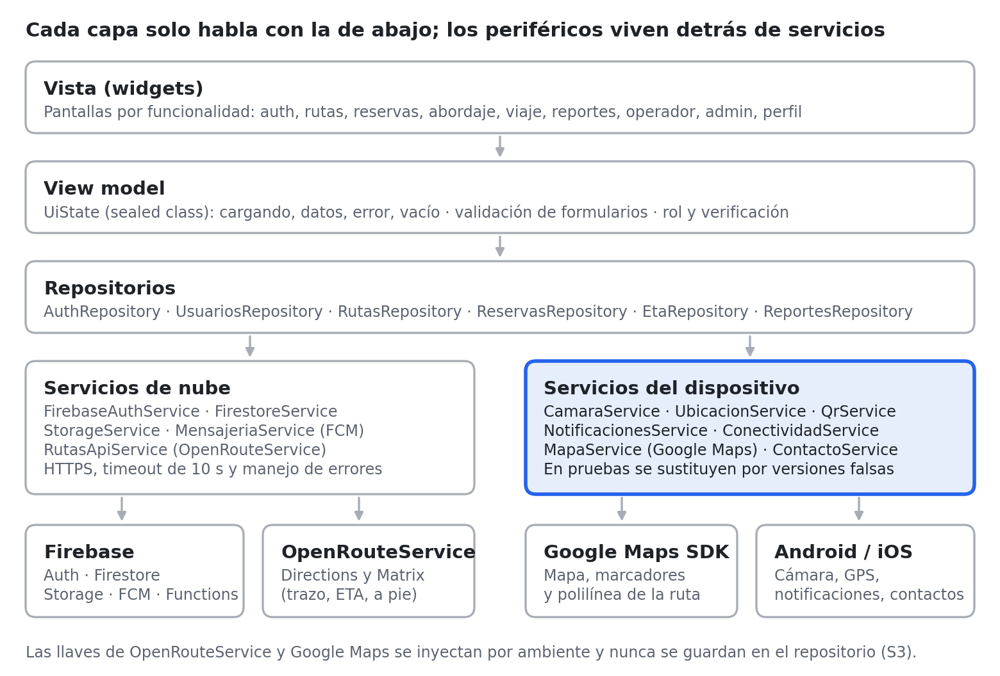

# Proyecto Integrador DMI — Transporte Exclusivo Estudiantil (UTEZ)

## 1. Caso y criterios de admisión

**Transporte Exclusivo Estudiantil** es una app Flutter para que estudiantes de la UTEZ reserven asiento en combis aliadas, sigan la unidad y aborden con un QR, con servicios en Firebase.

| Criterio de admisión | Cómo lo cumple el caso |
|:---|:---|
| Problema real y describible | El estudiante no tiene lugar garantizado en el transporte, no sabe cuándo llega la unidad y viaja con efectivo y lo percibe inseguro. |
| Datos que justifican autenticación y protección | Correo, datos personales, foto de credencial, ubicación y aprobación de abordaje. |
| Nube + API de terceros pertinente |  |
| Usa P1, P2, P3 + Optativas O2, O3, O6, O7. | Foto de credencial, ubicación para la parada más cercana, recordatorio de salida; QR de abordaje y mapa de rutas. |
| Cabe en el cuatrimestre y se puede probar | El MVP se limita a 2–3 rutas de demostración; pagos y GPS de combis reales se simulan (sección 3). |

## 2. Problema, roles e historias de usuario

La app tiene tres roles: **estudiante** (usuario principal), **operador** (chofer de la combi aliada) y **administrador** (encargado de la universidad). Cada capacidad del dispositivo responde a una historia de este listado.

| ID | Rol | Historia de usuario | Requisito / capacidad |
|:---|:---|:---|:---|
| HU1 | Estudiante | Como estudiante quiero registrarme con mi correo institucional para que solo viajen estudiantes. | F1 |
| HU2 | Estudiante | Como estudiante quiero subir una foto de mi credencial para que verifiquen mi cuenta. | P1 |
| HU3 | Estudiante | Como estudiante quiero ver la parada más cercana a mí para saber dónde abordar. | P2 |
| HU4 | Estudiante | Como estudiante quiero reservar o cancelar mi asiento en una salida. | F2 |
| HU5 | Estudiante | Como estudiante quiero que me recuerden 15 minutos antes de que salga mi combi. | P3 |
| HU6 | Estudiante | Como estudiante quiero ver la ruta, las paradas y la combi en un mapa. | O3 + F3 |
| HU7 | Estudiante | Como estudiante quiero escanear el QR de la combi para confirmar que abordé. | O2 |
| HU8 | Estudiante | Como estudiante quiero compartir mi viaje en curso con mis contactos registrados. | O10 |
| HU9 | Estudiante | Como estudiante quiero reportar un incidente. | P1 + P2 + O7 |
| HU10 | Operador | Como operador quiero registrarme con mi correo y datos personales. |  |
| HU11 | Operador | Como operador quiero iniciar un recorrido para que los estudiantes vean dónde voy. | P2 (operador) |
| HU12 | Operador | Como operador quiero visualizar la lista de abordaje. |  |
| HU13 | Operador | Como operador quiero generar el QR de checkList. |  |
| HU14 | Operador | Como operador quiero reportar un incidente o emergencia. |  |
| HU15 | Administrador | Como administrador quiero dar de alta rutas, paradas y salidas, y aprobar credenciales. | F2 |
| HU16 | Administrador | Como administrador quiero visualizar la lista de incidencias. |  |

## 3. Alcance del MVP

El MVP demuestra el flujo completo **registro → reserva → recordatorio → abordaje con QR → viaje con ETA** en 2–3 rutas de prueba. Lo que depende de terceros reales (cobro, combis con GPS) se simula para que el proyecto quepa en el cuatrimestre.

| Entra en el MVP | Se simula | Queda fuera (versión futura) |
|:---|:---|:---|
| Registro con correo institucional y verificación de credencial | Pago: monedero con saldo de prueba (sin cobro real) | Cobro real con tarjeta o SPEI |
| Visualización de rutas, paradas y salidas | Posición de la combi: modo operador en un segundo teléfono, o simulador que recorre la ruta. | Integración con el GPS de las unidades concesionadas |
| Reservar y cancelar asiento | Aprobación de credencial por un administrador de la institución. | Validación automática contra el sistema escolar. |
| Mapa con ruta y paradas. |  | Ubicación en segundo plano (O12) |
| QR de abordaje, compartir viaje, reporte de incidentes. |  | Versión iOS publicada (solo se documenta) |
| Perfil, ajustes, privacidad y permisos |  |  |

Si el equipo quiere un pago real, la opción más directa es Mercado Pago en modo *sandbox* como segunda API; no es obligatoria.

## 4. Requisitos funcionales F1–F7

Cada requisito mínimo tiene una implementación concreta en el caso y una forma de demostrarlo.

| ID | Implementación en Transporte Exclusivo Estudiantil | Cómo se demuestra |
|:---|:---|:---|
| F1 | Firebase Auth con correo y contraseña: registro (solo dominio institucional), verificación de correo, inicio y cierre de sesión, restauración al reabrir y "Olvidé mi contraseña". | Demo + prueba de integración del flujo login → inicio |
| F2 | Entidad del usuario: **reservas** (alta = reservar, consulta = mis reservas, baja = cancelar). Segunda entidad: **reportes de incidente** del usuario. Visualización de rutas, paradas y salidas administrados por el rol admin. | Demo + reglas de Firestore probadas en el emulador |
| F3 | OpenRouteService (Directions y Matrix) detrás de RutasApiService → EtaRepository, con timeout de 10 s, manejo de errores y llave por ambiente. | Código + prueba con coordenadas inválidas y respuesta vacía |
| F4 | Un aproximado de 20 pantallas (sección 7), incluida Perfil y ajustes con privacidad, permisos y notificaciones. | Demo |
| F5 | Validación en el formulario de registro, reserva y reporte (correo institucional, campos obligatorios, longitud) y las mismas reglas en Firestore (request.resource.data). | Prueba de widget + reglas |
| F6 | Toda pantalla remota usa UiState con 4 estados: cargando, datos, error con "Reintentar" y vacío ("No tienes reservas"). | Prueba de widget |
| F7 | ConectividadService (connectivity_plus + prueba real de red) muestra un banner sin conexión y botón Reintentar; Firestore conserva la caché offline. | Demo en modo avión |

Una reserva solo se crea si hay asientos: se usa una **transacción** de Firestore que descuenta asientosDisponibles de la salida, para evitar sobrecupo.

## 5. Modelo de datos y servicios en la nube

El backend es **Firebase**: Authentication, Cloud Firestore, Cloud Storage, Cloud Messaging y Cloud Functions (esta última solo para el push de O6). Desde octubre de 2024, Cloud Storage exige el plan **Blaze** (pago por uso con tarjeta vinculada); el uso de un proyecto escolar queda dentro de la cuota sin costo y la misma cuenta de facturación habilita Google Maps (sección 6). Se configura una alerta de presupuesto de 1 USD para detectar cualquier cargo.

Los permisos dependen de usuarios/{uid}.rol y solo cuentan cuando estadoVerificacion es aprobada. Resumen de acceso por colección:

| **Colección** | **Lee** | **Escribe** |
|----|----|----|
| usuarios | Dueño y administrador | Dueño, sin poder cambiar rol ni estadoVerificacion; el administrador aprueba o rechaza |
| rutas | Cualquier usuario autenticado | Administrador |
| paradas | Cualquier usuario autenticado | Administrador |
| salidas | Cualquier usuario autenticado | Administrador crea y cancela; el operador asignado actualiza la suya; el estudiante solo mueve asientosDisponibles en ±1 dentro de la transacción de su reserva |
| reservas | Dueño, operador de esa salida y administrador | El estudiante crea, cambia la parada y cancela la suya; el operador la marca como abordada |
| reportes | Autor y administrador | El autor crea y edita mientras está abierto; el administrador cambia estado y nota |

### 5.1 usuarios/{uid}

El id del documento es el uid de Firebase Auth.

| **Campo** | **Tipo** | **Regla** |
|----|----|----|
| nombre | string | 2 a 80, obligatorio |
| apellidoPaterno | string | 2 a 80, obligatorio |
| apellidoMaterno | string | 0 a 80 |
| correo | string | Igual al correo del token; dominio institucional para el rol estudiante |
| rol | string | estudiante, operador o administrador. Al registrarse solo los dos primeros |
| estadoVerificacion | string | pendiente, aprobada o rechazada. Solo el administrador lo cambia |
| credencialPath | string o null | Se borra al aprobar o rechazar |
| notificacionesActivas | bool | Valor inicial: true |
| avisoPrivacidadAceptado | bool | Tiene que ser true al registrarse |
| avisoPrivacidadAceptadoEn | timestamp | Momento de la aceptación |
| municipio | string o null | Respaldo si la persona niega la ubicación |
| creadoEn, actualizadoEn | timestamp | creadoEn no se puede mover hacia atrás |

- **Operador:** la regla de dominio institucional aplica solo al rol estudiante. El operador se registra con su correo y queda pendiente hasta que el administrador lo aprueba; mientras tanto no puede usar ninguna función de operador.

- **Administrador:** nadie puede registrarse con ese rol; la cuenta la crea el equipo desde la consola de Firebase.

- **Adición propuesta para O6:** subcolección usuarios/{uid}/dispositivos/{tokenId} con token (string), plataforma (android o ios) y actualizadoEn. La escribe el dueño, la lee la Cloud Function y se borra al cerrar sesión.

### 5.2 rutas/{rutaId}

Cualquier usuario autenticado lee. Solo el administrador escribe.

| **Campo** | **Tipo** | **Regla** |
|----|----|----|
| nombre | string | 3 a 80 |
| descripcion | string | 0 a 240 |
| activa | bool | El mapa solo muestra las activas |
| color | string | Color hex del trazo |
| polyline | string | Trazo de OpenRouteService, guardado al crear o editar |
| distanciaMetros | number | Mayor a 0 |
| duracionSegundos | number | Mayor a 0 |
| municipio | string | Filtro cuando no hay GPS |
| creadoPor | string | uid del administrador |
| creadoEn, actualizadoEn | timestamp |  |

### 5.3 paradas/{paradaId}

Cualquier usuario autenticado lee. Solo el administrador escribe.

| **Campo**  | **Tipo** | **Regla**                         |
|------------|----------|-----------------------------------|
| rutaId     | string   | La ruta debe existir              |
| nombre     | string   | 2 a 80                            |
| orden      | number   | De 1 a n, único dentro de la ruta |
| lat, lng   | number   | Dentro de Morelos                 |
| municipio  | string   |                                   |
| referencia | string   | 0 a 120                           |

### 5.4 salidas/{salidaId}

El administrador las crea. El operador asignado actualiza la suya. El estudiante solo puede subir o bajar asientosDisponibles en 1, dentro de la transacción de la reserva, y el valor no puede quedar negativo.

| **Campo** | **Tipo** | **Regla** |
|----|----|----|
| rutaId | string | Ruta activa |
| operadorId | string o null | Se llena al iniciar el recorrido |
| aliasUnidad | string | Ejemplo: Combi 12 |
| fechaHora | timestamp | Horario programado |
| asientosTotales | number | Mayor a 0. No cambia después de publicar la salida |
| asientosDisponibles | number | Solo cambia ±1 en una transacción |
| estado | string | programada, enCurso, finalizada o cancelada |
| ubicacionActual | geopoint o null | Se borra al pasar a finalizada |
| ubicacionActualEn | timestamp o null |  |
| etaPorParada | map | Minutos por parada. Lo escribe el operador |
| qrToken | string | Aleatorio. Cambia al iniciar el recorrido |
| qrExpiraEn | timestamp |  |
| creadaPor | string | uid del administrador |
| creadoEn | timestamp |  |

**Riesgo del QR:** qrToken vive en un documento que cualquier usuario autenticado puede leer, así que un estudiante podría obtenerlo sin estar en la combi. En el MVP se mitiga con el token que cambia al iniciar el recorrido, el vencimiento de qrExpiraEn y la lista de abordaje del operador (HU12), que puede revertir un abordaje. Mejora: mover el token a salidas/{salidaId}/privado/qr, legible solo por el operador; las reglas lo pueden comparar con get() aunque el estudiante no tenga permiso de lectura.

### 5.5 reservas/{salidaId}\_{uid}

El estudiante lee y escribe la suya. El operador de esa salida puede pasarla a abordada. El administrador lee todas. El id compuesto impide que un estudiante tenga dos reservas en la misma salida; si cancela y vuelve a reservar, se reutiliza el documento.

| **Campo**   | **Tipo**         | **Regla**                                 |
|-------------|------------------|-------------------------------------------|
| usuarioId   | string           | Igual al uid autenticado                  |
| salidaId    | string           | Salida programada o en curso              |
| rutaId      | string           | Copia para listar sin otra consulta       |
| paradaId    | string           | Parada de esa ruta                        |
| estado      | string           | reservada, cancelada o abordada           |
| creadaEn    | timestamp        |                                           |
| canceladaEn | timestamp o null | Al cancelar se devuelve 1 asiento         |
| abordadaEn  | timestamp o null | Solo si el QR corresponde a esa salida    |
| anonimizada | bool             | A los 6 meses se quita el usuario visible |

**Edición (F2):** el enunciado pide alta, consulta, edición y baja. La edición de la reserva es **cambiar \`paradaId\`** mientras la reserva está en reservada y la salida en programada. Esta operación debe agregarse a la fila F2 de la sección 4.

### 5.6 reportes/{reporteId}

El autor lo crea y lo lee. El administrador lee todos y cambia el estado. El contacto de la optativa O7 no se guarda. El autor puede editar descripcion y la foto mientras el estado sea abierto (segunda entidad con edición para F2).

| **Campo** | **Tipo** | **Regla** |
|----|----|----|
| autorId | string | uid |
| rolAutor | string | estudiante u operador |
| salidaId | string o null | Si el incidente ocurre en un viaje |
| tipo | string | seguridad, retraso, unidad u otro |
| descripcion | string | 10 a 500 |
| fotoPath | string o null | Opcional. Se conserva 12 meses |
| lat, lng | number o null | Zona del reporte, no un rastreo |
| zonaTexto | string | Municipio o referencia |
| estado | string | abierto, enRevision o cerrado. Solo el administrador lo mueve |
| creadoEn | timestamp |  |
| resueltoEn | timestamp o null |  |
| notaAdmin | string o null | 0 a 500 |

### 5.7 Cloud Storage

| **Ruta** | **Quién** |
|----|----|
| credenciales/{uid}/credencial.jpg | Escribe el dueño. Leen dueño y administrador. Se borra al aprobar o rechazar. Solo image/jpeg, máximo 2 MB |
| reportes/{reporteId}/foto.jpg | Escribe el autor del reporte (la regla lo comprueba con firestore.get() sobre reportes/{reporteId}). Leen autor y administrador. Máximo 2 MB |

### 5.8 Índices compuestos

- salidas por rutaId y fechaHora

- reservas por usuarioId y creadaEn descendente

- reservas por salidaId y estado (lista de abordaje y push de O6)

- reportes por estado y creadoEn descendente

- paradas por rutaId y orden

*En el borrador el índice de reservas usaba* creadoEn*, pero el campo de la colección se llama* creadaEn*; el índice debe usar el nombre real.*

### 5.9 Quién cambia un estado

| **Entidad** | **Transición** | **Quién** | **Efecto** |
|----|----|----|----|
| Usuario | pendiente → aprobada o rechazada | Administrador | Se borra la foto de credencial |
| Salida | programada → enCurso | Operador asignado | Nuevo qrToken; empieza a enviar ubicación y ETA; push O6 |
| Salida | enCurso → finalizada | Operador asignado | Se borra ubicacionActual |
| Salida | programada → cancelada | Administrador | Push O6 a quienes reservaron |
| Reserva | (nueva) → reservada | Estudiante | Descuenta 1 asiento en la misma transacción |
| Reserva | reservada → cancelada | Estudiante | Devuelve 1 asiento y cancela el recordatorio P3 |
| Reserva | reservada → abordada | Estudiante con QR válido u operador desde la lista | Se llena abordadaEn |
| Reporte | abierto → enRevision → cerrado | Administrador | Se llenan resueltoEn y notaAdmin |

## 6. API de terceros (F3) y mapas

F3 se cubre con **OpenRouteService (ORS)** detrás de RutasApiService → EtaRepository, como se aprobó en la sección 4. El mapa de la optativa O3 se dibuja con **Google Maps** mediante google_maps_flutter: Google Maps muestra el mapa, los marcadores y la polilínea, y no reemplaza a ORS en el cálculo de rutas ni de ETA.

| **Uso en la app** | **Servicio** | **Quién lo llama** | **Frecuencia** | **Dónde se guarda** |
|----|----|----|----|----|
| Trazo, distancia y duración de la ruta | ORS Directions (driving-car) | Administrador al crear o editar la ruta | Solo al crear o editar | polyline, distanciaMetros, duracionSegundos en rutas |
| ETA de la combi a cada parada | ORS Matrix (driving-car) | App del operador durante el recorrido | 1 por minuto por salida en curso | etaPorParada en salidas |
| Camino a pie a la parada | ORS Directions (foot-walking) | App del estudiante al tocar "Cómo llego" | 1 por consulta | No se guarda |
| Mapa, paradas y combi en vivo | Google Maps SDK (Android e iOS) | Pantallas Mapa de rutas y Viaje en curso | Cada vez que se abre el mapa | — |

El plan Standard gratuito de ORS permite 2,000 consultas de Directions y 500 de Matrix al día; como proyecto académico se puede pedir el plan Collaborative, que no permite uso comercial. La polilínea de ORS viene codificada con el mismo algoritmo que usa Google, así que se decodifica a una lista de LatLng y se dibuja como Polyline.

### Requisitos de F3 y S7 en el código

- RutasApiService (cliente http con timeout de 10 s) → EtaRepository → view model. La vista nunca llama a la API directamente.

- Errores mapeados a mensajes de usuario: sin red, tiempo agotado, 401/403 (llave), 429 (límite) y 5xx; una respuesta inválida o vacía muestra "ETA no disponible".

- Validación de la respuesta antes de usarla: coordenadas dentro de Morelos y duración positiva.

- La llave de ORS se inyecta con --dart-define-from-file=env/dev.json; env/\*.json está en .gitignore y el repo solo trae env/example.json.

- Riesgo documentado: una llave dentro del APK puede extraerse; se limita con cuota diaria. Mejora opcional: llamar a ORS desde una Cloud Function.

### Google Maps: activación y llave

- Activar **Maps SDK for Android** y **Maps SDK for iOS** en el mismo proyecto de Google Cloud que Firebase. El uso de mapas nativos en móvil no tiene límite de cargas, pero el proyecto necesita una cuenta de facturación activa (la misma del plan Blaze).

- La llave va fuera del repositorio, como pide O3: en Android se lee de local.properties (ignorado por git) y se inyecta en el manifiesto con manifestPlaceholders; en iOS se lee de un archivo .xcconfig no versionado.

- Restringir la llave en Google Cloud a las dos APIs de Maps y a la app: nombre de paquete más la huella SHA-1 del keystore de debug de cada integrante y del keystore de release.

- El punto azul del usuario (myLocationEnabled) solo se activa después de conceder la ubicación; si se niega, el mapa funciona sin él.

## 7. Pantallas y navegación (F4)

Se contemplan **entre 18 y 20 pantallas**. La lista es tentativa: puede aumentar o disminuir conforme avance el desarrollo. La propuesta actual tiene 20 (el mínimo del enunciado es 6); la pantalla de carga inicial y los diálogos previos a cada permiso no se cuentan.

| **\#** | **Pantalla** | **Rol** | **Qué hace** | **Requisitos** | **Historias** |
|----|----|----|----|----|----|
| 1 | Inicio de sesión | Todos | Correo, contraseña y "Olvidé mi contraseña" | F1, F5 | HU1, HU10 |
| 2 | Registro | Estudiante y operador | Nombre y apellidos, correo, rol, municipio y aceptación del aviso | F1, F5, S6 | HU1, HU10 |
| 3 | Recuperar contraseña | Todos | Envía el correo de restablecimiento | F1 | — |
| 4 | Verificación de cuenta | Estudiante y operador | Estado de la cuenta y foto de credencial | P1 | HU2 |
| 5 | Aviso de privacidad | Todos | Aviso simplificado (LFPDPPP) | S6 | — |
| 6 | Inicio | Estudiante | Próxima reserva, ETA y accesos rápidos | F6, P3 | HU5 |
| 7 | Mapa de rutas | Estudiante | Google Maps con rutas, paradas, combi en vivo y parada más cercana | O3, P2, F3 | HU3, HU6 |
| 8 | Salidas y reserva | Estudiante | Horarios, asientos disponibles, elegir parada y reservar | F2, F5 | HU4 |
| 9 | Mis reservas | Estudiante | Consultar, cambiar parada y cancelar | F2, F6 | HU4 |
| 10 | Abordar (QR) | Estudiante | Escanear el QR que muestra el operador | O2 | HU7 |
| 11 | Viaje en curso | Estudiante | Combi en el mapa, ETA a su parada y botón de incidente | O3, F3 | HU6 |
| 12 | Reportar incidente | Estudiante y operador | Tipo, descripción, foto, zona y contacto de emergencia | F2, P1, P2, O7 | HU9, HU14 |
| 13 | Mis reportes | Estudiante y operador | Consultar y editar reportes abiertos | F2, F6 | HU9, HU14 |
| 14 | Mis salidas | Operador | Salidas asignadas del día | F6 | HU11 |
| 15 | Recorrido en curso | Operador | Iniciar y terminar, compartir ubicación y mostrar el QR | P2, O2 | HU11, HU13 |
| 16 | Lista de abordaje | Operador | Quién reservó y quién abordó; marcar abordaje manual | F2, F6 | HU12 |
| 17 | Verificaciones | Administrador | Aprobar o rechazar estudiantes y operadores | P1 | HU15 |
| 18 | Rutas, paradas y salidas | Administrador | Alta, edición y baja del catálogo | F2, F3 | HU15 |
| 19 | Incidencias | Administrador | Lista y detalle de reportes, cambio de estado y nota | F2, F6 | HU16 |
| 20 | Perfil y ajustes | Todos | Datos, permisos, interruptor de notificaciones, aviso y eliminar cuenta | F4, P3, S6 | — |

**Navegación:** go_router con redirección según la sesión y el rol. Sin sesión se va a Inicio de sesión; con cuenta pendiente o rechazada, a Verificación; con cuenta aprobada, al inicio de su rol. Cada rol tiene su barra inferior:

- Estudiante: Inicio, Mapa, Mis reservas y Perfil.

- Operador: Mis salidas, Reportes y Perfil.

- Administrador: Verificaciones, Catálogo, Incidencias y Perfil.

Si hay que recortar, las candidatas son "Aviso de privacidad" (puede ser una hoja modal) y "Mis reportes" (puede integrarse en Perfil), con lo que quedan 18. Si crecen, las siguientes serían el detalle de una incidencia y la edición del perfil.

## 8. Seguridad S1–S8 y privacidad (LFPDPPP)

La seguridad se apoya en cuatro decisiones: verificación de cuenta antes de usar la app, reglas por rol y por dueño, cupo controlado en la misma transacción que la reserva, y ninguna llave en el repositorio.

| **ID** | **Medida concreta en el proyecto** |
|----|----|
| S1 | El token lo gestiona Firebase Auth; los datos de sesión propios (rol y estado de verificación en caché) van en flutter_secure_storage. Nada sensible en SharedPreferences. |
| S2 | Todo el tráfico por HTTPS (Firebase, OpenRouteService y Google Maps); usesCleartextTraffic="false" en Android y ATS activo en iOS. |
| S3 | .gitignore con env/\*.json, local.properties, key.properties, \*.jks, google-services.json y GoogleService-Info.plist; llaves de ORS y Google Maps por ambiente; env/example.json como plantilla; revisión con gitleaks antes de cada PR. |
| S4 | Reglas de Firestore y Storage de la sección 5 con privilegio mínimo por rol y dueño, probadas con el emulador (@firebase/rules-unit-testing). |
| S5 | Logger propio que en release no imprime nada y nunca registra correo, token, qrToken ni coordenadas; mensajes de error genéricos para el usuario. |
| S6 | Inventario de datos (abajo); aviso de privacidad simplificado en Registro y en Perfil; aceptación registrada en avisoPrivacidadAceptadoEn. |
| S7 | Validadores compartidos con las longitudes y valores de la sección 5, iguales en el cliente y en las reglas; validación de las respuestas de ORS y del contenido del QR. |
| S8 | Solo paquetes de publisher verificado (incluido google_maps_flutter, publicado por flutter.dev); flutter pub outdated en cada hito y versiones registradas en docs/permisos.md. |

**Inventario de datos (S6).** Se recolecta solo lo necesario; no se piden matrícula, teléfono ni dirección.

| **Dato** | **Origen** | **Finalidad** | **¿Sube a la nube?** | **Retención** |
|----|----|----|----|----|
| Nombre, apellidos y correo | Registro | Identificar la cuenta | Sí (Auth y usuarios) | Mientras exista la cuenta |
| Rol, verificación y municipio | Registro | Permisos y alternativa sin GPS | Sí (usuarios) | Mientras exista la cuenta |
| Aceptación del aviso | Registro | Evidencia de consentimiento | Sí (usuarios) | Mientras exista la cuenta |
| Foto de credencial | Cámara o galería (P1) | Verificar a la persona | Sí (Storage, dueño y administrador) | Se borra al aprobar o rechazar |
| Ubicación del estudiante | GPS (P2) | Parada más cercana y camino a pie | No | No se guarda |
| Ubicación de la combi | GPS del operador (P2) | Mostrar la unidad y calcular el ETA | Sí (salidas) | Se borra al finalizar la salida |
| Reservas | Uso de la app | Apartar asiento y validar abordaje | Sí (reservas) | 6 meses; luego se anonimizan |
| Reportes (texto, foto, zona) | Formulario, P1 y P2 | Atender incidentes | Sí (reportes y Storage) | 12 meses |
| Token de push | FCM (O6) | Avisos de la salida reservada | Sí (dispositivos) | Se borra al cerrar sesión |
| Contacto de emergencia | Selector del sistema (O7) | Avisar a un contacto | No | No se guarda |
| Preferencia de notificaciones | Ajustes | Recordatorios | Sí (usuarios) | Mientras exista la cuenta |

En Perfil se incluye **Eliminar mi cuenta**, que borra el usuario, sus reservas, reportes, fotos y tokens (derechos ARCO de la LFPDPPP). Los plazos de retención son una propuesta del equipo.

## 9. Capacidades del dispositivo

El equipo tiene 6 integrantes, así que necesita 6 puntos de optativas. Las elegidas en la sección 1 (O2, O3, O6 y O7) suman **7 puntos**, sin capacidades de 3 puntos que requieran aprobación.

### Base obligatoria

| **ID** | **Uso en el caso** | **Paquete** | **Servicio** | **Si se niega** |
|----|----|----|----|----|
| P1 Cámara o galería | Foto de credencial (estudiante y operador) y foto opcional del reporte; se reduce con maxWidth: 1280 e imageQuality: 70 antes de subir a Storage. | image_picker | CamaraService | Elegir de galería; en el reporte, enviar sin foto |
| P2 Ubicación en primer plano | Estudiante: al tocar "Parada más cercana" o "Cómo llego". Operador: solo mientras su salida está en curso y la app abierta, con indicador visible. Reporte: al tocar "Agregar ubicación". Si el GPS está apagado, se avisa y se ofrece la alternativa. | geolocator + permission_handler | UbicacionService | Elegir municipio y parada de una lista; en el reporte, escribir la zona |
| P3 Notificaciones | Recordatorio local 15 minutos antes de la salida reservada; se programa al reservar y se cancela al cancelar. Interruptor en Ajustes (notificacionesActivas). | flutter_local_notifications | NotificacionesService | Aviso dentro de la app en Inicio |

### Optativas elegidas

| **ID** | **Pts** | **Uso en el caso** | **Historia** | **Paquete** | **Permisos** |
|----|----|----|----|----|----|
| O2 Escáner QR | 2 | El operador muestra un QR al iniciar el recorrido (generado con qr_flutter, sin permisos); el estudiante lo escanea y su reserva pasa a abordada si el token coincide y no venció. | HU7, HU13 | mobile_scanner | CAMERA · NSCameraUsageDescription |
| O3 Mapa interactivo | 2 | Google Maps con las rutas activas (polilínea), paradas y combi en vivo; al tocar una parada muestra horarios y ETA. | HU3, HU6 | google_maps_flutter | Reutiliza P2 · llave de Maps fuera del repo |
| O6 Push segmentado | 2 | Una Cloud Function detecta cuando una salida pasa a enCurso o cancelada y envía un push solo a quienes tienen reserva en ella y notificaciones activas. P3 sigue siendo local, como exige el enunciado. | HU17 (por agregar) | firebase_messaging + Cloud Functions | POST_NOTIFICATIONS · capability Push en iOS |
| O7 Contacto | 1 | En el reporte de incidente, elegir un contacto con el selector del sistema y abrir WhatsApp, SMS o llamada con wa.me, sms: o tel:. El contacto no se guarda. | HU9, HU14 | Selector del sistema + url_launcher | Sin READ_CONTACTS ni CALL_PHONE |

## 10. Borrador de docs/permisos.md

Sigue las columnas de la sección 4.5 del enunciado. La columna de evidencia se llena con capturas del dispositivo físico en H6.

| **Capacidad** | **Permiso Android (tipo)** | **Clave iOS** | **Historia** | **Momento de la solicitud** | **Si se niega** | **Dato, finalidad y retención** | **Evidencia (3 estados)** |
|----|----|----|----|----|----|----|----|
| P1 Cámara y galería | CAMERA (ejecución); galería con el selector de fotos, sin permisos de almacenamiento | NSCameraUsageDescription, NSPhotoLibraryUsageDescription | HU2, HU9, HU14 | Al tocar "Tomar foto de credencial" o "Agregar foto" | Elegir de galería; reporte sin foto | Credencial: se borra al resolver. Foto de reporte: 12 meses | Pendiente |
| P2 Ubicación | ACCESS_COARSE_LOCATION (ejecución); ACCESS_FINE_LOCATION solo para el operador | NSLocationWhenInUseUsageDescription | HU3, HU11 | Al tocar "Parada más cercana", "Agregar ubicación" o "Iniciar recorrido" | Elegir municipio, parada o zona | Estudiante: no se guarda. Operador: hasta finalizar la salida. Reporte: 12 meses | Pendiente |
| P3 Notificaciones locales | POST_NOTIFICATIONS (ejecución, Android 13+); sin SCHEDULE_EXACT_ALARM | Autorización en ejecución | HU5 | Al confirmar la primera reserva | Aviso dentro de la app | Preferencia on/off; mientras exista la cuenta | Pendiente |
| O2 QR | CAMERA (ejecución) | NSCameraUsageDescription | HU7, HU13 | Al tocar "Abordar" | El operador marca el abordaje en la lista | El token no se guarda en el dispositivo | Pendiente |
| O3 Mapa | Reutiliza P2; llave de Maps por ambiente | Reutiliza la de P2 | HU6 | Solo si el usuario pide su ubicación en el mapa | Mapa sin punto del usuario | Ninguno adicional | Pendiente |
| O6 Push | POST_NOTIFICATIONS (compartido con P3) | Capability Push Notifications + autorización | HU17 | Al confirmar la primera reserva, junto con P3 | Solo avisos dentro de la app | Token FCM; se borra al cerrar sesión | Pendiente |
| O7 Contacto | Ninguno (selector del sistema) | — | HU9, HU14 | Al tocar "Avisar a un contacto" | Escribir el número a mano | El contacto no se guarda | — |

**Justificación de ACCESS_FINE_LOCATION:** el ETA se calcula desde la posición de la combi; con ubicación aproximada (hasta cientos de metros) el error sería de varios minutos. Para el estudiante y para los reportes basta la aproximada.

**Textos de propósito (en español, en Info.plist y en el diálogo previo):**

- Cámara: "Usamos la cámara para tomar la foto de tu credencial y verificar tu cuenta, para agregar una foto a un reporte o para escanear el código QR al subir a la combi."

- Galería: "Elige una foto de tu credencial para verificar tu cuenta o una imagen para tu reporte."

- Ubicación: "Usamos tu ubicación solo cuando lo pides: para mostrarte la parada más cercana o, si eres operador, para que los estudiantes vean la combi mientras tu recorrido está activo."

- Notificaciones: "Te avisaremos 15 minutos antes de que salga la combi que reservaste y si tu salida inicia o se cancela. Puedes desactivarlo en Ajustes."

Recordatorio de la regla 1: revisar el AndroidManifest **fusionado** del APK de release, porque mobile_scanner, image_picker, google_maps_flutter y firebase_messaging pueden agregar permisos; los que no se usan se quitan con tools:node="remove".

## 11. Arquitectura por capas

La app sigue **vista → view model → repositorio → servicio**, con carpetas por funcionalidad y una carpeta lib/core/services con un servicio por capacidad del dispositivo, para sustituirlo por una versión falsa en las pruebas.

La biblioteca de estado es la elegida en la tarea 02; la arquitectura no depende de cuál sea. Hay dos ambientes, dev y prod, cada uno con su archivo env/\*.json; para desarrollo se usa el Emulator Suite de Firebase y así no se consume cuota real.

## 12. Plan de pruebas

Se proponen 10 unitarias, 5 de widget y 1 de integración (el mínimo es 8, 4 y 1), ejecutables con un solo comando mediante un script scripts/test.ps1 que corre flutter test, flutter test integration_test y las pruebas de reglas. Los servicios del dispositivo se sustituyen por versiones falsas.

**Unitarias (lógica y view models)**

1.  Validadores: nombre y apellidos de 2 a 80, descripción del reporte de 10 a 500 y correo institucional para estudiantes.

2.  El id de la reserva se forma como {salidaId}\_{uid}.

3.  ReservaViewModel no permite reservar si asientosDisponibles es 0 o la salida no está programada.

4.  Cancelar pasa la reserva a cancelada, llena canceladaEn y cancela el recordatorio local.

5.  Cambiar la parada solo se permite en estado reservada.

6.  Cálculo de la parada más cercana con coordenadas conocidas.

7.  Decodificación de la polilínea de ORS a puntos LatLng.

8.  EtaRepository: timeout, 429 y 5xx devuelven un error de dominio, no una excepción.

9.  EtaRepository: una respuesta con coordenadas fuera de Morelos o duración negativa se rechaza (S7).

10. Validación del QR: rechaza el token de otra salida o uno vencido según qrExpiraEn.

**Widget**

1.  Mis reservas muestra cargando, datos, error con "Reintentar" y vacío (F6).

2.  Permiso de ubicación denegado permanentemente: botón "Abrir ajustes" y lista de municipios como alternativa.

3.  Formulario de registro: muestra los errores de validación (F5).

4.  El banner sin conexión aparece y "Reintentar" vuelve a cargar (F7).

5.  En Ajustes, el interruptor de notificaciones cancela los recordatorios.

**Integración (flujo principal):** iniciar sesión → abrir el mapa → reservar asiento → ver la reserva en Mis reservas → cambiar la parada → cancelar, contra el emulador de Firebase.

**Pruebas de reglas (S4):** un estudiante no puede leer una reserva ajena, bajar el cupo sin reservar ni cambiar su rol; un operador solo actualiza su salida; la foto de credencial solo la leen el dueño y el administrador.

**Dispositivo físico:** P1 y P2 en sus tres estados (concedido, denegado y denegado permanentemente), con capturas en docs/pruebas.md.

## 13. Liberación y distribución

La versión de la defensa será **1.0.0+N** (SemVer más número de build), firmada con un keystore que vive solo en la máquina del responsable de distribución y en un gestor de contraseñas del equipo.

| **Modo** | **Qué se hace** | **Evidencia en docs/distribucion/** |
|----|----|----|
| Interna | APK de release instalado en un teléfono limpio, o Firebase App Distribution al grupo de prueba | Versión, hash SHA-256 del APK y capturas |
| Privada | Pista de pruebas internas de Google Play si alguien tiene cuenta de desarrollador; si no, el procedimiento documentado | Capturas de la consola o el procedimiento |
| Pública | Expediente: ficha, descripción, ícono 512×512, capturas, clasificación de contenido, formulario de Seguridad de los datos y URL de la política de privacidad | Carpeta con todos los archivos |

- La huella SHA-1 del keystore de release se registra en Firebase y en la restricción de la llave de Google Maps; sin ella, el APK de release mostrará el mapa en gris.

- El formulario de Seguridad de los datos debe coincidir con el inventario de la sección 8: nombre, correo, fotos, ubicación aproximada y precisa (operador), identificadores del dispositivo para push, cifrado en tránsito y opción de eliminar la cuenta.

- iOS y AppGallery solo se documentan. La política de privacidad puede publicarse gratis en GitHub Pages.

## 14. Riesgos y decisiones pendientes

| **Riesgo** | **Impacto** | **Mitigación** |
|----|----|----|
| Storage, Cloud Functions y Google Maps requieren facturación (plan Blaze) | Sin tarjeta no hay fotos, push ni mapa | Una persona vincula la tarjeta; alerta de presupuesto de 1 USD y cuotas diarias bajas |
| qrToken legible en salidas | Un estudiante podría marcar abordaje sin subir | Token rotativo con vencimiento y lista del operador; mejora: subdocumento privado |
| Registro con rol de operador sin control | Alguien podría hacerse pasar por operador | Las funciones de operador exigen aprobación del administrador |
| Llaves de ORS o Google Maps dentro del APK | Uso indebido de la cuota | Llaves restringidas por app y API, con cuota diaria |
| Huella SHA-1 distinta en cada computadora | El mapa sale en gris para algún integrante | Registrar la SHA-1 de debug de cada integrante en la restricción de la llave |
| Plugins que agregan permisos al manifiesto | Falla el mínimo privilegio | Revisar el manifiesto fusionado en cada hito |
| El correo de estudiantes no usa un dominio único | La regla de dominio no sirve | Confirmar el dominio; si no, verificar solo con la credencial |
| Nadie del equipo tiene Mac | No se compila para iOS | Configurar Info.plist y la llave de Maps en iOS y documentarlo |
